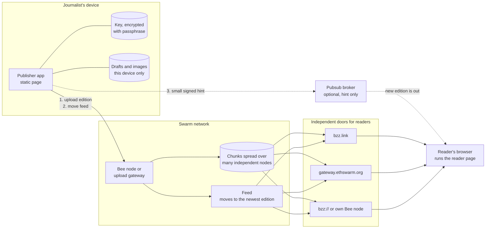
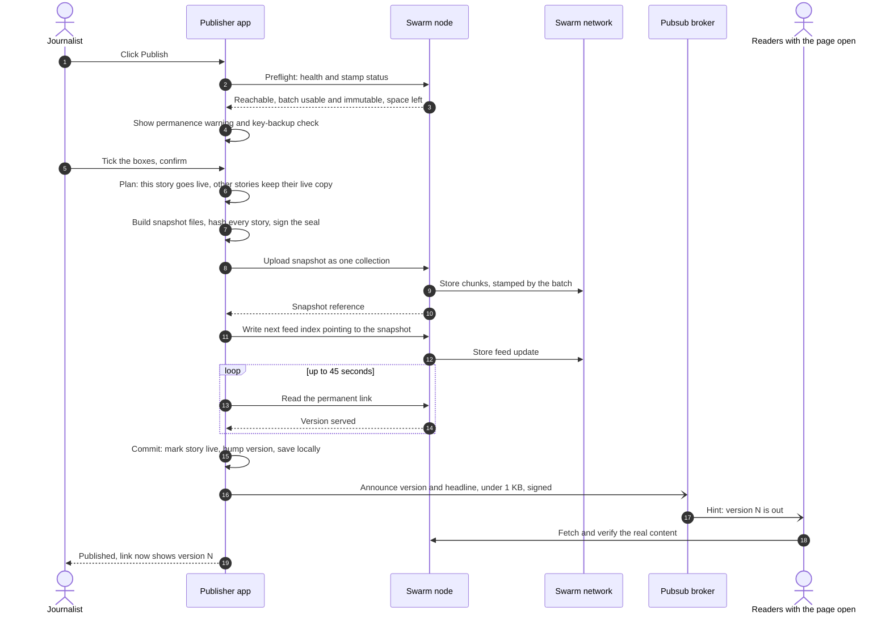
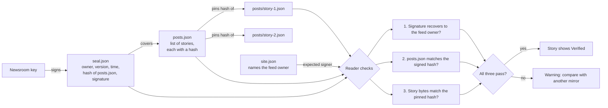
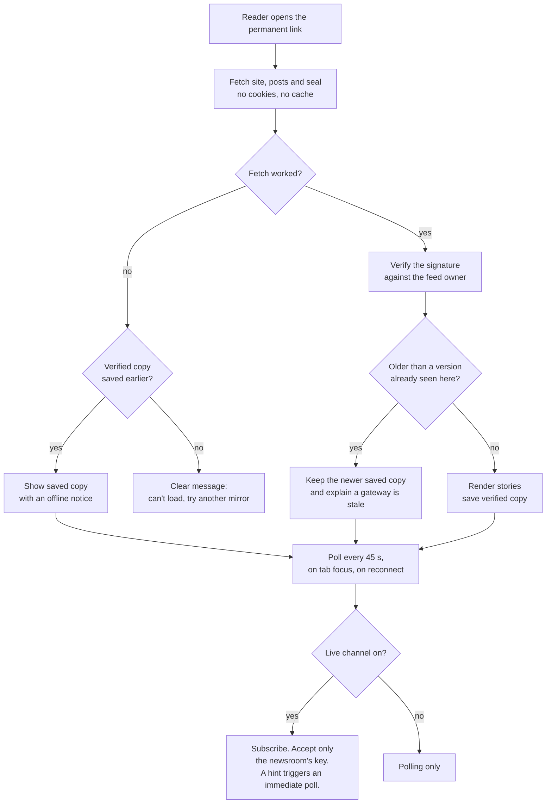

# Parcha

### A newsroom that can't be switched off.

[](https://github.com/tannmayygupta/parcha/actions/workflows/ci.yml)


Write stories. Publish them to [Swarm](https://www.ethswarm.org). Give readers **one link that always shows the latest edition**, even after the newsroom's own server and domain are gone.

Built for **Devcon 8 · Build Battle 1: Censorship-Free World**.

Parcha (पर्चा) is the Hindi/Urdu word for the leaflet, the cheap hand-passed sheet that news travels on when the press is closed.

**Jump to:** [The problem](#the-problem) · [How it works](#how-it-works-in-plain-words) · [Flow charts](#flow-charts) · [Challenge checklist](#challenge-checklist-brief-to-code) · [Features](#features) · [Run it](#run-it) · [Honest status](#honest-status) · [Limits](#limits-we-state-openly) · [FAQ](#faq)

---

## The problem

Small newsrooms, tenants' unions and community archives get taken down by hosting suspensions, domain seizures, payment-processor bans and takedown notices. Every one of those pressure points is a *company* that can be asked to switch something off.

Parcha takes the company out of the path:

| What usually gets taken down | What Parcha does instead |
|---|---|
| The web server | The site is a set of files stored across many independent Swarm nodes. There is no host to suspend. |
| The domain name | The link is a **Swarm feed manifest**: a fixed address derived from the newsroom's key, not from a registrar. |
| The CMS / admin panel | The publisher app is a static page. It can live on Swarm and talks straight to a Swarm node. |
| "The one file to lock" | Content is split into chunks and spread over the network. |

## The test, and how Parcha passes it

> *Once your own server and domain are gone, that link still shows their latest work.*

1. The link is `bzz://<feed manifest>`. On every Swarm gateway and node it resolves to **whatever the newsroom's key last pointed the feed at**.
2. Publishing means uploading a complete new snapshot of the site and then moving the feed to it. The link never changes. Its content does.
3. Nothing in the reader depends on us: a static page, relative URLs, no third-party requests, no API of ours.
4. `npm run verify -- <link>` is the kill test, automated. It asks each independent door into Swarm for the latest edition and checks the publisher's **signature** on what comes back. See [docs/KILL-TEST.md](docs/KILL-TEST.md).

---

## How it works, in plain words

**Setting up (once, about five minutes)**
1. The journalist names the newsroom and chooses a passphrase.
2. The app creates a **key** inside the browser. The key is locked with the passphrase and never leaves the device. A backup file is downloaded.
3. The journalist gives the app the address of a Swarm node and a **storage batch** (prepaid storage).
4. The app creates the **permanent link**. This is the one link readers get.

**Publishing a story (every time)**
1. Write in the editor. Add photos (the app strips location data and shrinks them). A live preview shows exactly what readers will see.
2. Press Publish. The app checks the node and the storage, then says plainly that **publishing is permanent**.
3. The app builds a complete copy of the site, signs it, uploads it to Swarm, and moves the feed to it.
4. It reads the permanent link back to confirm it now serves the new edition.
5. Readers who have the page open get an instant nudge. Everyone else gets the new edition within a minute.

**Reading**
Readers open the link in any browser. They see the stories, a **Verified** mark proving the newsroom signed them, and a list of alternative mirrors. If a gateway is blocked or stale, they switch mirror, or use their own node.

**Disaster recovery**
Lost laptop? Open the app anywhere, enter the link and the key backup. Every story and image is downloaded **from Swarm itself** and the newsroom carries on at the same link.

---

## Flow charts

These render on GitHub. The complete set (12 diagrams) is in **[docs/FLOWS.md](docs/FLOWS.md)**.

### System overview



### Publishing a story



### How readers know a story is genuine



### What a reader's browser does



### Where else to look

| Diagram | What it shows |
|---|---|
| [Failure handling](docs/FLOWS.md#3-what-happens-when-publishing-fails) | Retries, what is blocked, why a failed publish never half-applies |
| [Live layer](docs/FLOWS.md#6-the-live-layer-pubsub) | Pubsub as a hint, with the poll as the safety net |
| [Storage health](docs/FLOWS.md#7-storage-health-postage-stamps) | Every threshold that turns the stamp meter amber or red |
| [Key lifecycle](docs/FLOWS.md#8-key-lifecycle) | From secure random to encrypted, unlocked and restored |
| [Story lifecycle](docs/FLOWS.md#9-story-lifecycle) | Draft, live, live with edits, retracted |
| [Recovery](docs/FLOWS.md#10-recovery-on-a-new-device) | New device from link and key |
| [Photo pipeline](docs/FLOWS.md#11-photo-pipeline) | Why a photo can't leak where it was taken |
| [Kill test](docs/FLOWS.md#12-the-kill-test) | The pass/fail protocol |

---

## Challenge checklist (brief to code)

| The brief asks for | Where it is |
|---|---|
| A real person's work that keeps getting taken down | [Who it's for](#who-its-for) |
| Something they can publish to, with **one link readers can keep** | Feed manifest link: `src/swarm/client.ts` (`ensureManifest`), `src/shared/gateways.ts` |
| Link still shows the latest work when our server and domain are gone | No server in the path. [Kill test](docs/KILL-TEST.md), `scripts/verify-link.ts` |
| **Postage stamps** | Immutable-batch check, TTL and bucket-usage meter, publish blocked on bad batches: `src/swarm/stamp-health.ts`, `src/publisher/publish.ts`. Top-up/dilute/buy tooling: `scripts/provision.ts` |
| **Feeds** | One feed per newsroom, written on every publish, read back to confirm: `SwarmClient.pointFeedAt`, `latestFeed`, `confirm` |
| **Sharing** via bzz.link or ENS | bzz.link URLs via CID encoding (`src/shared/cid.ts`), multiple gateways, `bzz://`, local-node URL. The feed manifest is exactly what an ENS content hash should point at (see [Roadmap](#roadmap)) |
| **swarm-pubsub** as the live layer | `src/live/protocol.ts`, `src/reader/live.ts`, `announceLive`. **Feed is the record, pubsub the hint.** Messages are under 1 KB (limit 4 KB) and carry no content |
| Keep a fallback if pubsub misbehaves | Reader polls every 45 s regardless. Pubsub is lazily loaded so it can never block the page |
| Messages aren't stored, so keep the record in Swarm | Every edition is stored on Swarm and chained by hashes and a signature |
| Tooling: bee-js, TypeScript, Vite | `@ethersphere/bee-js` 13, TypeScript, Vite (`swarm-cli` is not required) |
| Judge reads code, doesn't run it | Evidence is in the repo: tests, [docs](docs/), CI, an honest [status table](#honest-status) |

---

## Features

### For the journalist
- **Guided setup** and plain-language errors. A failed upload says what happened and what to do.
- **Editor** with live preview, Markdown, breaking-news alerts, and autosave on the device.
- **Photos are cleaned**: GPS, camera and time data are removed and the image is shrunk to at most 1600 px before it ever leaves the device.
- **Permanence is explicit.** The publish dialog says it can't be undone. Mistakes are handled by **retractions** (a visible notice, original stays), not a fake delete button.
- **Storage health always visible**: time left, space left, and a hard warning for mutable batches, which can break feeds.
- **Key safety**: passphrase-encrypted (PBKDF2-SHA256, 600k rounds, AES-256-GCM), downloadable backup, and the first publish is gated on confirming a backup.
- **Recovery with no database**: link plus key restores everything from Swarm.
- **Live alerts** to readers, with a safe fallback.
- **Works in Indian languages**: language setting, right-to-left support for Urdu, Unicode-safe summaries and fonts.

### For the reader
- Works through **any gateway, subdomain or local node** (all URLs relative).
- **Verified** marks and tamper warnings from a signed chain of hashes.
- **Never goes backwards**: a stale gateway can't hide an edition the reader has already seen.
- **Offline copy** of the last verified edition.
- **Mirror list**: bzz.link, gateway.ethswarm.org, `bzz://`, your own node.
- **Private by design**: no third-party requests, no cookies, no referrer, strict Content Security Policy, sanitised Markdown, images only from inside the edition.
- Responsive, accessible (skip link, focus styles, live regions), light and dark mode.

---

## Architecture

```
src/shared      data model, signing, snapshot builder, safe Markdown, gateways, CID   (used by everything)
src/swarm       Bee client, stamp health, error explanations, retry
src/publisher   journalist app: vault, newsroom state, publish, restore, UI
src/reader      the site readers see (packed into every snapshot)
src/live        pubsub announcement protocol
scripts         mock-bee, e2e, verify-link (kill test), provision, deploy-publisher, pack-reader
test            unit, integration and reader tests
docs            architecture, flow charts, threat model, kill test, runbook
```

**What one edition looks like on Swarm**

| Path | Content |
|---|---|
| `index.html`, `assets/*` | The reader app |
| `data/site.json` | Title, tagline, language, feed owner/topic/manifest, live channel |
| `data/posts.json` | Stories, newest first, each with the hash of its file |
| `data/posts/<id>.json` | One story: Markdown and metadata |
| `data/seal.json` | Newsroom's signature over `posts.json` |
| `media/<hash>.jpg` | Images, metadata removed |

Why full snapshots: the feed holds one 32-byte reference, so there is nothing to merge or lose. Any single snapshot is a complete site.

More: [docs/ARCHITECTURE.md](docs/ARCHITECTURE.md) · [docs/THREAT-MODEL.md](docs/THREAT-MODEL.md)

### Tech stack

| Layer | Choice |
|---|---|
| Language / build | TypeScript, Vite |
| Swarm | `@ethersphere/bee-js` 13 (collections, feeds, stamps), `swarm-pubsub` 0.1 |
| Crypto | `@noble/curves` (secp256k1), `@noble/hashes`, WebCrypto (PBKDF2, AES-GCM) |
| Content safety | `marked` (raw HTML disabled) + `DOMPurify` + CSP |
| Tests | Vitest, jsdom |
| CI | GitHub Actions: typecheck, tests, build, end-to-end |

### Design rules that came straight from the Swarm docs

- Feeds need an **immutable** batch: on a mutable one a full batch overwrites old chunks and can break feed lookups. Parcha flags mutable batches as critical.
- A batch is full when its **fullest bucket** is full, not at its nominal size, so the meter uses bucket utilisation.
- Pubsub messages are **not stored** and capped at 4 KB, so the feed is the record and pubsub only nudges.
- A 64-hex reference is longer than the 63-character DNS label limit, so bzz.link URLs use a base32 **CID**.

---

## Run it

Requires Node 22+.

```bash
npm install
npm test            # 54 tests: protocol, security, recovery, failure modes
npm run e2e         # the whole product, headless, against the built-in mock node
npm run mock-bee    # a local fake Bee on :1633 for developing the UI offline
npm run dev         # publisher app with hot reload
npm run build       # production build of reader + publisher (static files, relative URLs)
```

Against **real Swarm** (needs a Bee node with a funded wallet; see [docs/RUNBOOK.md](docs/RUNBOOK.md)):

```bash
npm run provision -- list                                # your postage batches
npm run provision -- buy --size 100MB --days 30 --yes    # immutable batch (spends xBZZ)
BEE_URL=http://localhost:1633 BATCH_ID=<id> npm run e2e
npm run verify -- <feed manifest> --min-version 2         # the kill test across gateways
BEE_URL=... BATCH_ID=... npm run deploy:publisher         # put the publisher app itself on Swarm
```

| Script | Purpose |
|---|---|
| `npm run dev` / `build` | Publisher app (and the reader it bundles) |
| `npm test` | Unit, integration and reader tests |
| `npm run e2e` | Headless end-to-end run. With `BEE_URL` and `BATCH_ID` it runs against real Swarm |
| `npm run verify` | **The kill test**: asks every gateway for the latest edition and checks the signature |
| `npm run provision` | List, price, buy, top up and dilute stamp batches |
| `npm run deploy:publisher` | Upload the publisher app to Swarm with its own permanent link |
| `npm run mock-bee` | Local protocol-level fake of a Bee node |

> **Secrets.** The Swarm gift code is a wallet private key. It belongs in your Bee node's configuration, never in this repository. `.env`, keystores and keys are git-ignored.

---

## Honest status

The judge can't run this, so here is exactly what has and hasn't been proven.

| Area | How it is verified |
|---|---|
| Snapshot building, signing, tamper detection | Unit tests |
| Publish, feed move, link serves latest; retries; lagging feeds; a failed publish leaves state untouched | Integration tests that drive the **real `bee-js` client** against a protocol-level mock Bee |
| Reader: rendering, hostile-Markdown sanitising, verified seal, tamper warning, offline fallback, never-go-backwards | jsdom tests against the mock |
| Stamp health and error explanations | Unit tests |
| Recovery from link and key; retraction rules; key vault | Integration tests |
| **Publisher UI in a real browser** | Not yet exercised end to end by automation |
| **Real Swarm network, real gateways, real pubsub broker** | **Pending first live run** (needs the Devcon gift-code wallet and a Bee node). Procedure: [docs/RUNBOOK.md](docs/RUNBOOK.md). Results will be recorded below |

The mock Bee (`scripts/mock-bee.ts`) is **not Swarm**. It proves our code speaks the protocol correctly, nothing more.

### Evidence from the live network

Not recorded yet. When the live run completes, this section will contain the feed manifest, the full `npm run verify` output for each gateway, and the date.

---

## Who it's for

Parcha is designed around the situation of a **small independent newsroom**, the kind with two to ten people, a regional focus, a shoestring budget and no IT staff:

- Their site is on a shared host or a platform, their domain is with one registrar, their payments go through one processor. **Any one of those can end the publication overnight.**
- They report in regional languages on stories that powerful people want gone, and they receive photos from sources whose safety depends on **what is hidden in the file**.
- When news breaks they need readers to see it within seconds, on phones and slow connections.
- Nobody on the team can run servers.

Every feature above maps to one of those facts. The mapping is in [docs/PERSONA.md](docs/PERSONA.md). A named pilot newsroom will be added with their consent. No real person or organisation is named here without it.

---

## Limits we state openly

- **Swarm can't delete.** That is the point, and also why we ship retractions and a permanence warning instead of a delete button.
- **Storage is prepaid.** If the batch expires, the network may drop the data. Parcha makes this visible and offers top-up, but someone has to pay.
- **Whoever holds the key owns the newsroom.** There is no recovery without the backup. We say so at every step.
- **Publishing needs a Swarm node that accepts uploads from a browser.** That means your own Bee node, or an upload-enabled gateway, reachable over HTTPS if the app is served over HTTPS.
- `swarm-pubsub` is v0.1.x. It is deliberately optional here.
- Gateways can block *themselves*; they can't block the network. Hence several mirrors, `bzz://` and a local-node link.
- Full list of threats and what remains: [docs/THREAT-MODEL.md](docs/THREAT-MODEL.md).

## Roadmap

- ENS name pointing at the feed manifest (the manifest is exactly the right content hash).
- Multi-writer newsrooms using pubsub seats for drafts and approvals.
- Signed "we have moved" notice for key rotation.
- Incremental uploads (reuse unchanged media by reference) if the live network shows re-upload costs.
- Searchable archive and RSS generated into each edition.

## FAQ

**Can anyone publish under our name?** Only the holder of the newsroom key. Readers verify signatures, so a forgery shows a warning.

**What if a gateway shows an old edition?** The reader never goes backwards past a verified version it has already seen, and tells the reader to try another mirror.

**What if the pubsub broker is down?** Nothing breaks. The page polls every 45 seconds. The broker only makes updates instant.

**Does a reader need Swarm software?** No. Any browser works through a gateway. Swarm-aware browsers and local nodes work too and are stronger.

**Can we delete a story?** No. Nobody can, which is the point. You can retract it with a visible notice.

**Does it work in Hindi, Urdu, Tamil…?** Yes: the language setting drives text direction and date formats, and the font stacks include Indic scripts.

## License

MIT
