# Flow charts

Every diagram here matches the code. File names point to where each step lives. GitHub renders these diagrams directly.

1. [System overview](#1-system-overview)
2. [Publishing a story](#2-publishing-a-story)
3. [What happens when publishing fails](#3-what-happens-when-publishing-fails)
4. [What a reader's browser does](#4-what-a-readers-browser-does)
5. [How readers know a story is genuine](#5-how-readers-know-a-story-is-genuine)
6. [The live layer (pubsub)](#6-the-live-layer-pubsub)
7. [Storage health (postage stamps)](#7-storage-health-postage-stamps)
8. [Key lifecycle](#8-key-lifecycle)
9. [Story lifecycle](#9-story-lifecycle)
10. [Recovery on a new device](#10-recovery-on-a-new-device)
11. [Photo pipeline](#11-photo-pipeline)
12. [The kill test](#12-the-kill-test)

---

## 1. System overview

Who talks to what. Notice that there is no box labelled "our server".

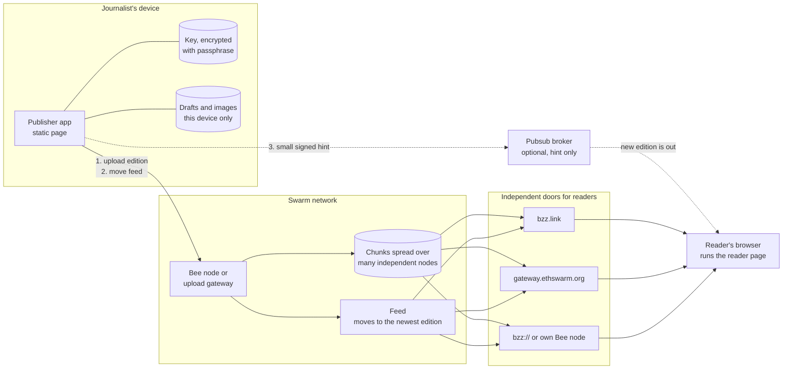

---

## 2. Publishing a story

Code: `src/publisher/publish.ts`, `src/swarm/client.ts`, `src/shared/snapshot.ts`.

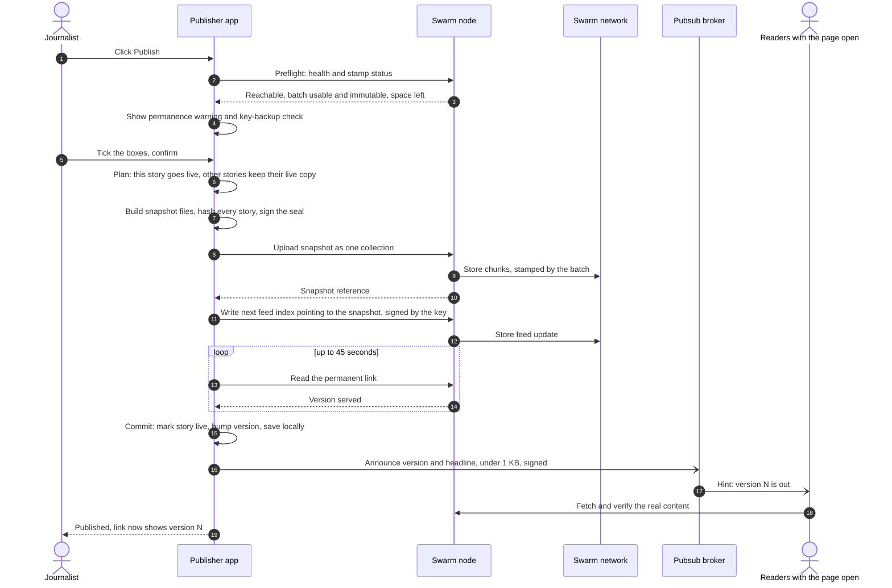

---

## 3. What happens when publishing fails

The rule: **local state changes only after Swarm confirmed everything**, so a failure at any step is safe to retry. Code: `src/swarm/retry.ts`, `src/swarm/errors.ts`.

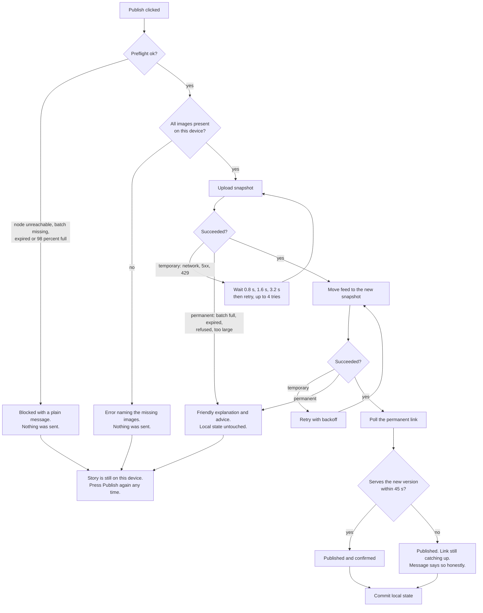

---

## 4. What a reader's browser does

Code: `src/reader/main.ts`, `src/reader/live.ts`. Every request is relative to the page's own address, so the same files work on any gateway.

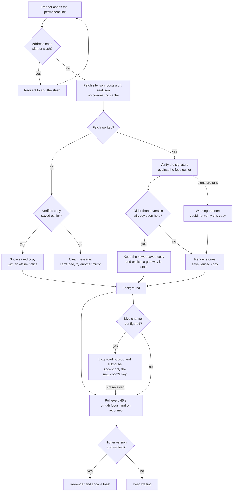

---

## 5. How readers know a story is genuine

Code: `src/shared/seal.ts`, `src/shared/snapshot.ts`. One signature protects the whole edition, and each story is pinned by a hash.

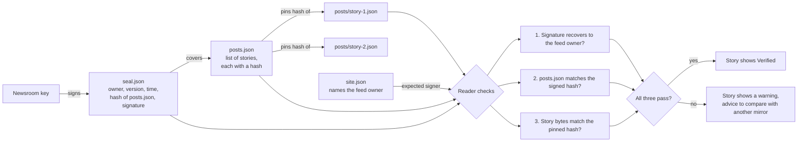

---

## 6. The live layer (pubsub)

Pubsub messages are not stored and are capped at 4 KB. So they are only a nudge. Code: `src/live/protocol.ts`, `src/reader/live.ts`, `announceLive` in `src/publisher/publish.ts`.

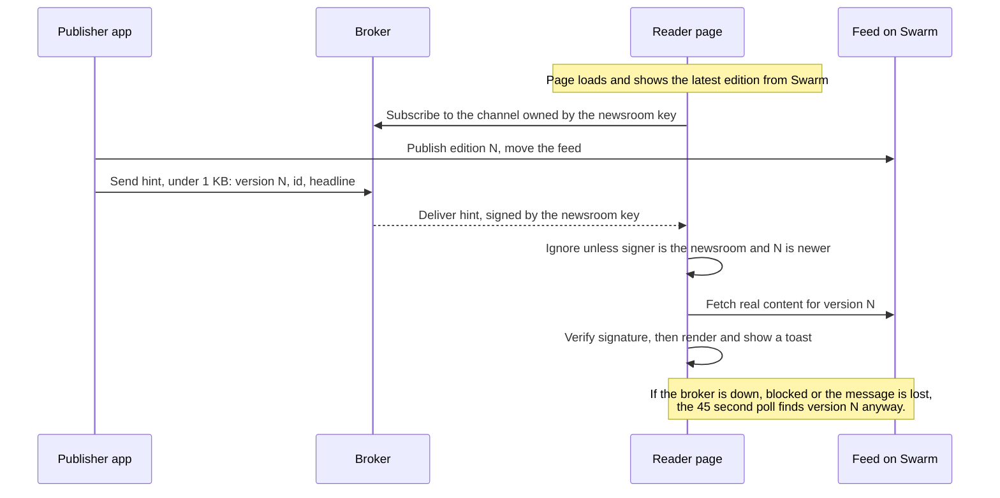

---

## 7. Storage health (postage stamps)

Code: `src/swarm/stamp-health.ts`. Swarm keeps data only while its stamp is alive, so the app always shows what is left.

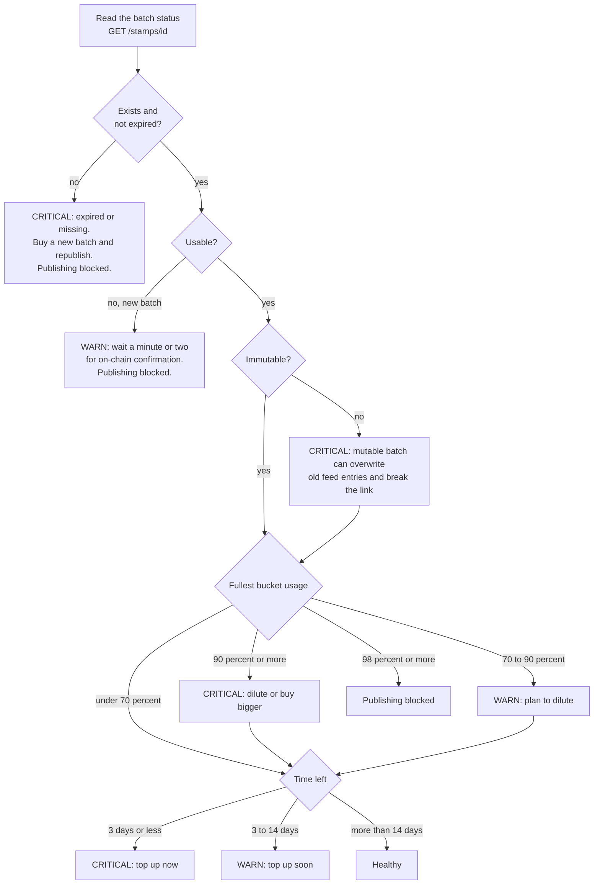

Why bucket usage: a batch is full when its single fullest bucket is full, long before its nominal size is reached.

---

## 8. Key lifecycle

Code: `src/publisher/vault.ts`. The key is the only thing that can move the permanent link.

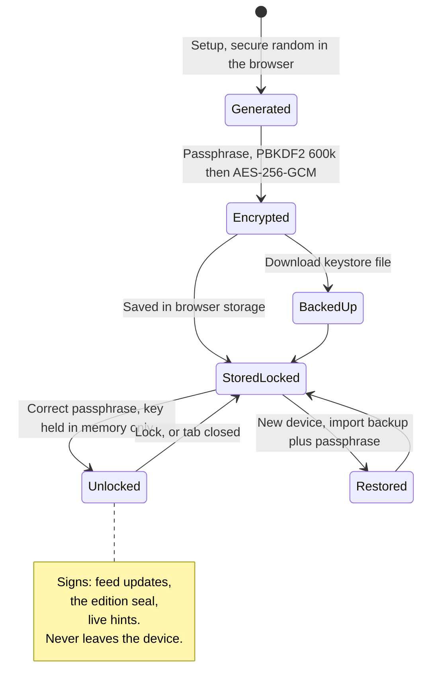

---

## 9. Story lifecycle

Code: `statusOf` in `src/publisher/newsroom.ts`. Each story keeps a private working copy and a live copy, so unfinished edits never leak when another story is published.

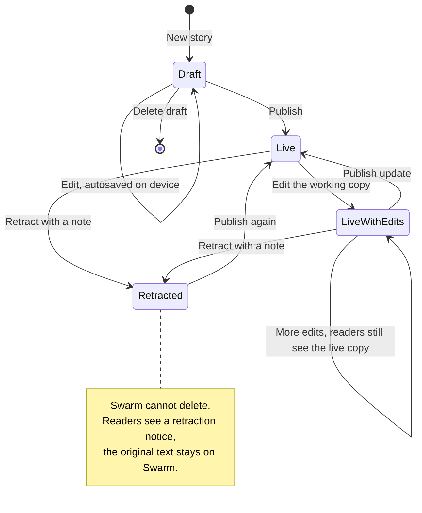

---

## 10. Recovery on a new device

Code: `src/publisher/restore.ts`. There is no database: the newsroom's data lives on Swarm.

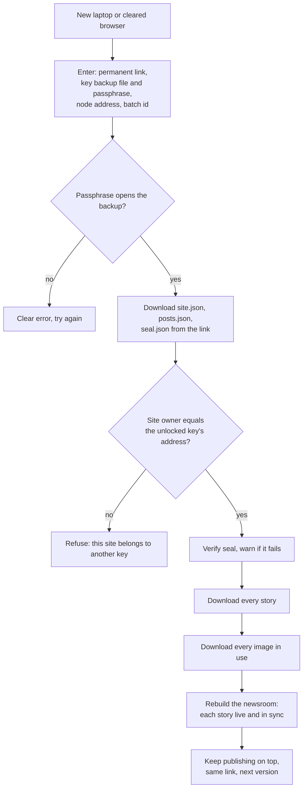

---

## 11. Photo pipeline

Code: `src/publisher/images.ts`. Photos carry GPS position, device serial numbers and times; re-drawing keeps only the pixels.

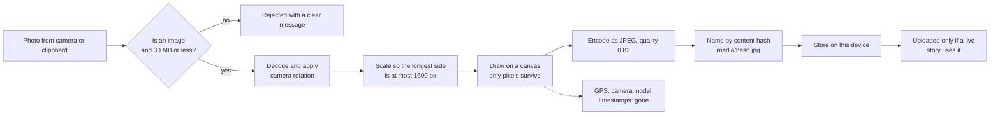

---

## 12. The kill test

Code: `scripts/verify-link.ts`, protocol in [KILL-TEST.md](KILL-TEST.md).

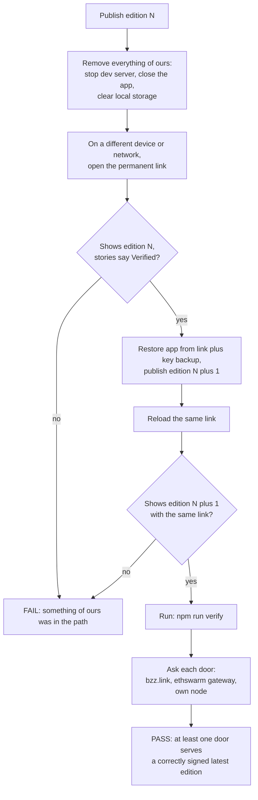
